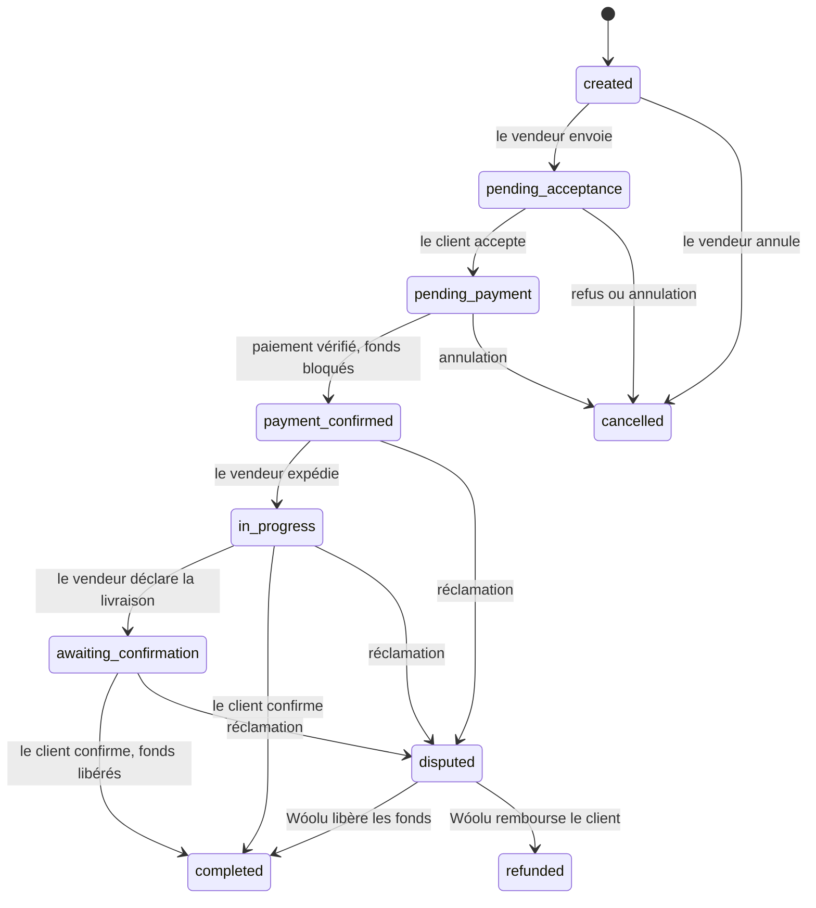
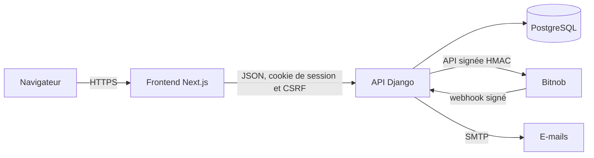

# Wóolu

**Le paiement qui attend la livraison.**

Wóolu sécurise les ventes à distance au Sénégal entre des personnes qui ne se connaissent pas. Le vendeur
propose des conditions écrites, le client les accepte puis paie Wóolu plutôt que le vendeur. Les fonds restent
bloqués (séquestre) pendant la livraison et ne sont libérés au vendeur qu'après confirmation du client, ou
par décision de l'équipe Wóolu en cas de litige. « Wóolu » signifie « confiance » en wolof.

| | Lien |
| --- | --- |
| Site (mode démonstration) | https://woolu.twoylit.tech |
| API | https://woolu-api.twoylit.tech |
| Documentation interactive de l'API (Swagger) | https://woolu-api.twoylit.tech/api/docs/ |
| Dépôt | https://github.com/LayeBALDEabdou/woolu |

## Sommaire

- [Le parcours d'une transaction](#le-parcours-dune-transaction)
- [Architecture](#architecture)
- [État d'avancement](#état-davancement)
- [Démarrage rapide](#démarrage-rapide)
- [Configuration](#configuration)
- [API](#api)
- [Tests](#tests)
- [Déploiement](#déploiement)
- [Sécurité](#sécurité)
- [Documentation détaillée](#documentation-détaillée)
- [Contribuer](#contribuer)

## Le parcours d'une transaction

1. **Le vendeur ou prestataire propose** : produit ou service, prix en francs CFA, date limite, délai de
   réclamation. En créant la transaction, il accepte ses propres conditions.
2. **Il l'envoie au client.** Avant l'envoi, la transaction est un brouillon invisible pour le client.
3. **Le client accepte ou refuse.** Il n'y a pas de contre-proposition : un refus annule la transaction.
4. **Le client paie.** Le paiement est confirmé par le serveur (webhook Bitnob), jamais par un clic ou une
   capture d'écran. Les fonds passent alors en séquestre : « fonds bloqués ».
5. **Le vendeur livre** : il déclare l'expédition, puis la fin de la livraison.
6. **Le client confirme la réception** : les fonds sont libérés au vendeur. En cas de problème, il ouvre une
   réclamation et l'équipe Wóolu tranche (libération ou remboursement).

Le statut de la transaction et l'état du séquestre sont deux informations distinctes. Seul le serveur fait
passer le séquestre à « fonds bloqués ».



Ce graphe est défini deux fois, à l'identique : dans `backend/transactions/models.py` (avec les règles
par rôle dans `rules.py`) et dans `frontend/src/features/transactions/domain/transitions.ts`. Toute
modification doit être faite des deux côtés.

## Architecture

```
woolu/
├── backend/                  API Django (Python)
│   ├── accounts/             Comptes, rôles, session, confirmation d'e-mail, mots de passe
│   ├── transactions/         Transactions sous séquestre, livraison, tableau de bord
│   ├── payments/             Client Bitnob (signature HMAC), adresses USDC, envois, webhook
│   └── config/               Réglages, routes, format des erreurs
├── frontend/                 Application web Next.js (TypeScript)
│   ├── src/features/         Un dossier par domaine : auth, transactions, payments, deliveries…
│   ├── src/mocks/            Backend simulé du mode démonstration
│   └── docs/                 Contrat d'API et décisions produit
├── .github/workflows/        CI/CD : tests, images Docker, déploiement
└── docker-compose.prod.yml   Services lancés sur le serveur de production
```



| Couche | Technologies |
| --- | --- |
| Frontend | Next.js 16 (App Router), React 19, TypeScript, Tailwind CSS 4, TanStack Query, React Hook Form, Zod |
| Backend | Django 6.1, Django REST Framework, django-cors-headers, Gunicorn, WhiteNoise |
| Données | PostgreSQL en production, SQLite en local |
| Paiement | Bitnob (API signée HMAC-SHA256, webhooks signés HMAC-SHA512) |
| Outillage | Vitest, Testing Library, Playwright, ESLint, Prettier |
| Livraison | Docker, GitHub Actions, GitHub Container Registry, VPS |

Le frontend a deux modes, fixés au moment du build :

- **`demo`** : toutes les données et tous les paiements sont simulés dans le navigateur. Aucun backend
  n'est nécessaire. C'est le mode du site en ligne aujourd'hui.
- **`api`** : le frontend appelle le backend Django. Les composants ne changent pas, seule
  l'implémentation des services change (`frontend/src/lib/services/index.ts`).

## État d'avancement

| Domaine | Backend | Frontend | Branchés ensemble |
| --- | --- | --- | --- |
| Authentification (inscription, confirmation d'e-mail, connexion, profil, mots de passe) | ✅ | ✅ | ✅ Vérifié de bout en bout |
| Transactions (création, envoi, acceptation, refus, annulation, liste, recherche) | ✅ | ✅ | ✅ Vérifié de bout en bout |
| Livraison et confirmation de réception | ✅ | ✅ | ✅ Vérifié de bout en bout |
| Tableau de bord | ✅ | ✅ | ✅ |
| Paiement | 🔶 Primitives Bitnob (adresses USDC, webhook), non reliées aux transactions | ✅ Interface (facture, QR code, suivi) | ❌ |
| Réclamations | ❌ | ✅ En mode démo | ❌ |
| Notifications | ❌ (e-mails de compte uniquement) | ✅ En mode démo | ❌ |

**Décision en attente sur le paiement.** L'interface est conçue pour Bitcoin Lightning via Bitnob ; le
backend a été basculé sur des dépôts USDC. Il faut choisir le moyen de paiement, puis exposer
`/api/transactions/{id}/payments` et faire appeler `Transaction.confirm_payment()` par le webhook Bitnob.

En attendant, pour tester la suite du parcours : dans l'admin Django (`/admin/`, section Transactions),
sélectionner la transaction puis lancer l'action **« Confirmer le paiement (fonds bloqués) »**.

## Démarrage rapide

Prérequis : **Node.js 20.9+** (24 en CI et en production) et **Python 3.12+** (3.13 en CI et en production).

### Frontend seul, en mode démonstration

```bash
cd frontend
npm install
npm run dev        # http://localhost:3000
```

Sur `/connexion`, choisissez un compte de démonstration. Le bouton « Changer de compte démo » permet de jouer
successivement le vendeur et le client, et un panneau orange simule les événements serveur (paiement reçu,
décision de litige).

### Application complète en local

**Terminal 1 : backend**, depuis `backend/`

```powershell
python -m venv .venv
.venv\Scripts\Activate.ps1          # Git Bash : source .venv/Scripts/activate
pip install -r requirements.txt
Copy-Item .env.example .env         # Git Bash : cp .env.example .env
python manage.py migrate
python manage.py createsuperuser    # facultatif : accès à /admin/
python manage.py runserver localhost:8000
```

**Terminal 2 : frontend**, depuis `frontend/`

```powershell
# PowerShell
$env:NEXT_PUBLIC_APP_MODE="api"; $env:NEXT_PUBLIC_API_BASE_URL="http://localhost:8000"; npm run dev
```

```bash
# Git Bash, macOS, Linux
NEXT_PUBLIC_APP_MODE=api NEXT_PUBLIC_API_BASE_URL=http://localhost:8000 npm run dev
```

Ouvrez ensuite http://localhost:3000.

À savoir :

- **Même nom d'hôte des deux côtés** : `localhost` partout. Avec `127.0.0.1` d'un seul côté, le frontend ne
  peut pas lire le cookie `csrftoken` et toutes les requêtes `POST` sont refusées.
- **E-mails** : sans `EMAIL_HOST` dans `backend/.env`, ils s'affichent dans le terminal du backend. Après une
  inscription, copiez le lien `http://localhost:3000/verification-email?token=…` dans le navigateur pour
  activer le compte.
- **Rôles** : seuls les comptes « vendeur » et « prestataire » peuvent créer une transaction.
- **Documentation de l'API en local** : http://localhost:8000/api/docs/

## Configuration

Les modèles de configuration sont `backend/.env.example` et `frontend/.env.example`.

### Backend (`backend/.env`)

| Variable | Rôle |
| --- | --- |
| `DJANGO_SECRET_KEY` | Clé secrète Django (obligatoire en production) |
| `DJANGO_DEBUG` | `1` en local, **`0` en production** |
| `DJANGO_ALLOWED_HOSTS` | Noms d'hôte acceptés, séparés par des virgules |
| `CORS_ALLOWED_ORIGINS` | Origines du frontend autorisées à appeler l'API (ex. `http://localhost:3000`) |
| `FRONTEND_URL` | Base des liens envoyés par e-mail (par défaut : la première origine CORS) |
| `CSRF_COOKIE_DOMAIN` | Domaine parent quand frontend et API sont sur deux sous-domaines (ex. `.twoylit.tech`) |
| `POSTGRES_DB`, `POSTGRES_USER`, `POSTGRES_PASSWORD`, `POSTGRES_HOST`, `POSTGRES_PORT` | PostgreSQL ; sans `POSTGRES_DB`, SQLite est utilisé |
| `EMAIL_HOST`, `EMAIL_PORT`, `EMAIL_HOST_USER`, `EMAIL_HOST_PASSWORD`, `DEFAULT_FROM_EMAIL` | Envoi réel des e-mails (SMTP) ; sinon affichage dans la console |
| `BITNOB_CLIENT_ID`, `BITNOB_CLIENT_SECRET`, `BITNOB_WEBHOOK_SECRET` | Clés Bitnob, **uniquement côté backend** |
| `BITNOB_PAIEMENTS_PUBLICS` | `1` : outils de paiement accessibles sans connexion, avec une clé sandbox uniquement |

### Frontend

| Variable | Rôle |
| --- | --- |
| `NEXT_PUBLIC_APP_MODE` | `demo` (défaut) ou `api` |
| `NEXT_PUBLIC_API_BASE_URL` | URL de l'API, obligatoire en mode `api` |

Ces variables sont **inlinées au build** : changer de mode impose de reconstruire. Toute variable
`NEXT_PUBLIC_*` est visible dans le navigateur ; aucune clé ne doit y figurer.

## API

Conventions communes :

- JSON en `camelCase` ; montants en entiers (`{ "amount": 185000, "currency": "XOF" }`).
- Authentification par **cookie de session httpOnly** ; en-tête `X-CSRFToken` sur les requêtes `POST`,
  `PATCH` et `DELETE`.
- Erreurs au format `{ "code": "VALIDATION", "message": "…", "fieldErrors": { "champ": "…" } }`, avec un
  message en français affichable tel quel.

| Groupe | Préfixe | Principaux endpoints |
| --- | --- | --- |
| Authentification | `/api/auth/` | `session`, `login`, `register`, `email/verify`, `email/resend`, `logout`, `password/forgot`, `password/reset`, `password/change`, `me` |
| Transactions | `/api/transactions` | liste et création ; `{id}` ; `{id}/send`, `accept`, `refuse`, `cancel` |
| Livraison | `/api/transactions/{id}/` | `delivery/start`, `delivery/complete`, `confirm-receipt` |
| Tableau de bord | `/api/dashboard/summary` | compteurs, fonds bloqués, actions à mener, activité récente |
| Outils Bitnob | `/payments/` | `adresses/`, `envois/`, `webhooks/bitnob/`, `whoami/` |

- Contrat complet, y compris les endpoints encore à implémenter : [`frontend/docs/API_ENDPOINTS.md`](frontend/docs/API_ENDPOINTS.md)
- Documentation interactive : `/api/docs/` (schéma OpenAPI sur `/api/schema/`)

## Tests

| Partie | Commande | Contenu |
| --- | --- | --- |
| Backend | `python manage.py test` (depuis `backend/`) | 53 tests : comptes et session, transactions et règles, paiements Bitnob |
| Frontend | `npm run lint`, `npm run typecheck`, `npm test` | 69 tests unitaires et de composants |
| Parcours | `npm run build && npm run test:e2e` | 6 parcours Playwright × 2 profils (ordinateur, mobile), en mode démo |

Playwright nécessite Chromium : `npx playwright install chromium`.

La CI exécute les tests backend et frontend (lint, types, tests, build) sur chaque pull request vers `main`.

## Déploiement

Chaque push sur `main` déclenche [`.github/workflows/ci-cd.yml`](.github/workflows/ci-cd.yml) :

1. **Tests** du backend et du frontend.
2. **Construction des images Docker** `woolu-backend` et `woolu-frontend`, poussées sur
   `ghcr.io/layebaldeabdou/` avec les tags `latest` et le SHA du commit.
3. **Déploiement** : copie de `docker-compose.prod.yml` sur le VPS par SSH, puis
   `docker compose pull` et `up -d`.

Sur le serveur :

| Service | Port | Démarrage |
| --- | --- | --- |
| `backend` | 8088 | `migrate` puis Gunicorn (3 workers) ; configuration lue dans le `.env` du dossier de l'application |
| `frontend` | 3004 | Serveur Next.js autonome (`server.js`) |

Le backend rejoint le réseau Docker externe `twoylit_postgres_network` pour atteindre PostgreSQL.

Secrets GitHub nécessaires : `VPS_HOST`, `VPS_USER`, `VPS_SSH_KEY`, `VPS_PORT` (facultatif, 22 par défaut) ;
variable facultative `VPS_APP_DIR` (`woolu` par défaut).

**Passer le site en ligne en mode `api`.** L'image du frontend est construite avec
`frontend/.env.production`, qui fixe aujourd'hui `NEXT_PUBLIC_APP_MODE=demo`. Il suffit d'y mettre `api`
puis de pousser sur `main` ; ne le faire qu'une fois le paiement branché, sinon les clients restent bloqués à
l'étape de paiement.

Liste de contrôle du `.env` de production :

- `DJANGO_DEBUG=0` et une vraie `DJANGO_SECRET_KEY` ;
- `DJANGO_ALLOWED_HOSTS=woolu-api.twoylit.tech` ;
- `CORS_ALLOWED_ORIGINS=https://woolu.twoylit.tech` et `FRONTEND_URL=https://woolu.twoylit.tech` ;
- `CSRF_COOKIE_DOMAIN=.twoylit.tech` (frontend et API sur deux sous-domaines) ;
- les variables `POSTGRES_*` et `EMAIL_*` ;
- les clés Bitnob, et l'URL de webhook déclarée chez Bitnob :
  `https://woolu-api.twoylit.tech/payments/webhooks/bitnob/`.

## Sécurité

- **Session** : cookie httpOnly, jamais de jeton dans le `localStorage` ; protection CSRF de Django.
- **Le frontend n'est pas une frontière de sécurité** : il masque les actions impossibles, mais le backend
  revalide chaque action (partie prenante, rôle, statut, séquestre) et verrouille la transaction en base
  pendant le changement de statut.
- **Confidentialité** : une transaction n'est visible que par ses deux parties (404 pour un tiers) ; un
  brouillon n'est pas visible par le client.
- **Comptes** : connexion impossible tant que l'adresse e-mail n'est pas confirmée ; les messages de
  connexion et de mot de passe oublié ne révèlent pas si un compte existe ; nombre d'essais limité.
- **Invitations** : une transaction adressée à une personne sans compte ne lui est rattachée qu'une fois son
  adresse e-mail confirmée.
- **Paiement** : clés Bitnob uniquement côté backend ; webhooks vérifiés par signature HMAC-SHA512 et
  dédoublonnés.
- ⚠️ **`POST /payments/envois/`** envoie de vrais fonds depuis le compte Bitnob et n'exige pas de connexion
  lorsque `DJANGO_DEBUG=1`. Il doit **impérativement** être désactivé en production (`DJANGO_DEBUG=0`).

## Documentation détaillée

| Document | Contenu |
| --- | --- |
| [`frontend/README.md`](frontend/README.md) | Architecture du frontend, mode démonstration, commandes, limites connues |
| [`frontend/docs/API_ENDPOINTS.md`](frontend/docs/API_ENDPOINTS.md) | Contrat d'API complet entre le frontend et le backend |
| [`frontend/docs/DECISIONS.md`](frontend/docs/DECISIONS.md) | Hypothèses métier à valider, choix techniques, identité visuelle |
| [`backend/README.md`](backend/README.md) | Installation et commandes du backend |
| `/api/docs/` | Documentation interactive de l'API (Swagger) |

## Contribuer

- Partir de `main` et créer une branche par sujet : `feat/…`, `fix/…`.
- Messages de commit en français, avec un sujet court et descriptif.
- Ouvrir une pull request vers `main` : la CI doit passer avant la fusion.
- Une règle métier qui change (statuts, transitions, rôles, montants, délais) se modifie **à la fois** dans
  le backend et dans le frontend, et se documente dans `frontend/docs/DECISIONS.md`.
